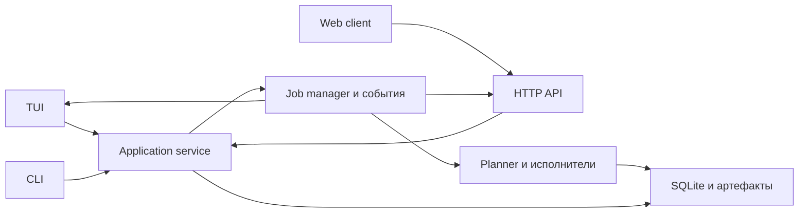

# Автоматизация сетевого аудита, понятный TUI и общий веб-интерфейс

Статус: первый рабочий этап реализован. Есть общий сервис фоновых задач,
обзор и мастер TUI, локальный HTTP API, Web и встроенный TUI в браузере.
Полная адаптивная автоматизация остаётся дорожной картой ниже.
Рабочий репозиторий — `sources/`; копия приложения в родительском каталоге
отличается и не должна становиться второй реализацией.

Цель: пользователь задаёт область и профиль работы, видит, что будет выполнено,
запускает одну задачу и получает объяснимые результаты и следующие действия.
TUI, Web и CLI используют одинаковые операции, параметры и ограничения.
Сеть с несколькими доменами, VPN, закрытым LDAP или нестандартными портами
не требует отдельного сценария с фиксированными именами GOAD.

## 1. Что уже сделано и где остаются пробелы

| Область | Текущее состояние | Следующий шаг |
|---|---|---|
| AD-разведка | `internal/adscan.Discover`: порты → LDAP → DNS SRV → связь с существующими IP | Подключить структурированные SMB/RDP/MSSQL-метаданные к тому же потоку |
| DC | AD DS подтверждается RootDSE capabilities; AD LDS исключается; DNS/порты дают предположение | Хранить подтверждение, дату и конфликтующие наблюдения в модели БД |
| DNS | Дополнительные серверы/домены, лимиты с диагностикой; A/AAAA не расширяют область | Настройки проекта, UDP-only DNS discovery, site-aware SRV и леса |
| Происхождение | LDAP/DNS-факты сохраняются с источниками в находках | Нормализованный каталог фактов и топологии, связь с исходным ответом |
| Задачи | `internal/app`: общие запуски, прогресс, отмена, журнал и SQLite-снимки | Ограниченная очередь, структурированные этапы и возобновление |
| Workflow | `internal/workflow.Runner` соединяет обычный discovery и проверки | Сделать план этапов и выполнение независимыми от интерфейса |
| Представление | Основные разделы централизованы, но много экранов/клавиш/форм | Единый мастер запуска, карточка узла и каталог действий |
| Хранилище | SQLite, проекты, сервисы, находки, учётки, история | Снимки планов, этапы, события, продолжение и артефакты |
| Веб | Локальный HTTP API, SSE, Web, совместный запуск с TUI | Нативные веб-проводники/консоли и полная матрица проверок |

Рефакторинг строится поверх имеющихся изменений `GUI_REFACTOR.md` и `RESULTS.md`.
Не возвращать отдельные экраны результатов для каждого источника.
Существующий нативный движок остаётся исполнителем. Новая оболочка не вводит
внешние Nmap/Nuclei/Metasploit как обязательные зависимости приложения.

## 2. Автоматический проход

Последовательность: область → обнаружение → идентификация → топология →
совместимые проверки → проверки с выбранными учётками → сводка → отчёт.
Этапы имеют условия запуска; отсутствующая предпосылка даёт «пропущено» с причиной.

| Этап | Вход/условие | Результат |
|---|---|---|
| Область | Явные CIDR/IP/URL, исключения, разрешённые DNS, выбранный профиль | Нормализованная область, оценка объёма и неизменяемый снимок параметров |
| Обнаружение | Адрес в области; быстрый/полный/пользовательский набор портов | Открытые порты; недоступность ICMP не исключает TCP-пробы |
| Идентификация | Реальный ответ протокола | Сервис, версия, hostname/FQDN, домен/лес, источник, дата, статус уверенности |
| Топология AD | LDAP/NTLM/DNS раскрыл домен или домен задан явно | Домены, DC/KDC/GC, сайты; доверия — только при наличии прочитанных данных |
| Без учётки | Доступен соответствующий сервис | LDAP RootDSE, SMB signing/диалекты/null/guest, RDP NTLM, доступность AD CS |
| С учёткой | Выбрана подходящая учётка и разрешён этот профиль | Чтение LDAP/групп/SPN/политик, SMB/SYSVOL, AD CS-конфигурации, проверки доступа |
| Другие сервисы | HTTP/SQL/SSH/FTP/WinRM и совместимый модуль | Выбранные проверки сервиса, доступные действия; поддержка нестандартного порта |
| Сводка | Завершение, отмена или частичное завершение | Что проверено, что пропущено, почему; подтверждённые сведения и предположения |
| Отчёт | Выбран запуск/область | JSON/HTML/CSV, доказательства, ограничения покрытия, рекомендации |

Обнаружение нового домена дополняет очередь запросов к разрешённым DNS.
Обнаружение адреса вне области создаёт запись топологии со статусом «вне области».
Сканирование такого адреса требует изменения области пользователем и нового плана.
Уже выполненные пары «операция + цель + параметры + контекст доступа» не запускаются
повторно в одном проходе. Изменение учётки разрешает повтор только зависимых этапов.
При конфликте FQDN/домена показывать оба наблюдения, не выбирать молча последнее.

Проверка SMB signing — отдельный факт. Наличие SPN, `adminCount`, флага pre-auth
или enrollment URL не приравнивать к доказанной эксплуатации/административным правам.
Kerberos: проектный resolver/realm, SPN, доступность KDC и расхождение времени;
не редактировать системные hosts/krb5.conf автоматически. Кэш билетов и его жизненный
цикл привязать к проекту/сессии, не передавать секреты через аргументы команд и журналы.

## 3. Профили и правила автоматизации

| Профиль | Что пользователь выбирает | Автоматическое поведение |
|---|---|---|
| Разведка сети | Область, обычная/медленная скорость | Обнаружение, идентификация и совместимые проверки без учётки |
| Аудит AD | Область, необязательные DNS/домены | Предыдущие этапы + топология и доступные AD-проверки |
| Аудит с учёткой | Учётка/домен, разрешённые сервисы | Чтение доступных данных и проверка выбранных доступов |
| Выбранные проверки | Хосты/порты, модули | Точный набор совместимых действий; несовместимые объясняются |
| Расширенные действия | Конкретное действие и параметры | Существующие ограничения AllowExploit/Code/CredentialAttack применяет общий сервис |

Профили задают набор возможностей, а не фиксированную последовательность атак.
Проверки паролей, перехват/принуждение аутентификации, запись файлов, выполнение
команд и постэксплуатация остаются отдельными явно выбранными операциями.
Сохранять уже заданные пользователем разрешения; интерфейсы не спрашивают их повторно
для каждого технического этапа, но сервер проверяет разрешение каждой операции.
План с расширенными действиями явно перечисляет их перед запуском.

При неизвестной политике блокировки не запускать массовые входы автоматически.
Счётчик отказов общий для всех интерфейсов и процессов владельца задач: домен/учётка,
окно, допустимое число ошибок, задержка, время следующей попытки. Несколько сервисов
не должны независимо исчерпывать лимит одной доменной учётки.

Сеть: общий лимит соединений, ограничения на хост/сервис, таймауты, повторы с backoff.
Отказ в доступе, NXDOMAIN, ошибка протокола и таймаут — разные состояния.
При отказе аутентификации зависимые действия не запускаются. При отмене прекращаются
новые запросы, закрываются соединения, сохраняются уже полученные результаты.

## 4. Основная навигация и пользовательские маршруты

Пять разделов проекта: **Обзор**, **Хосты**, **Результаты**, **Задачи**, **Доступы**.
Область/подсети доступны из Обзора; настройки проекта и общие настройки разделены.
Настройки не занимают постоянную основную вкладку. Каталог модулей и интерактивные
консоли открываются из выбранного хоста/сервиса и относятся к той же области.

На Обзоре одна главная кнопка: «Начать проверку». Остальное: «Изменить область»,
краткая сводка текущих результатов, текущая задача и понятное следующее действие.
Пустой проект: «Добавьте сеть или хост, затем запустите проверку».
Пустые результаты: «Проверка ещё не выполнялась» или конкретная причина пропуска.

Первый запуск: Проекты → Создать проект → Название и область → Профиль → Сводка →
Запустить → Задача → Результаты. Из проекта: Обзор → Начать проверку → тот же мастер.
Продолжение с учёткой: Результаты → «Недоступно без учётки» → Выбрать/добавить учётку →
Показать изменившиеся этапы → Запустить. Из узла: Хосты → узел → сервис → действие.

Мастер запуска:

1. **Область**: текущий проект/выбранные хосты/один сервис; адреса и исключения видимы.
2. **Профиль**: 3–4 понятных варианта, краткое описание и необязательная учётка.
3. **Перед запуском**: что выполнится, что пропущено, скорость, сохранение, ограничения.

«Дополнительные параметры» раскрывает DNS, домены, порты, таймауты, параллельность,
повторы и выбор отдельных проверок. Рядом с каждым параметром пример и значение
по умолчанию. Изменение запуска не меняет настройки проекта без «Сохранить как профиль».
Устанавливать профиль по умолчанию только для нового запуска, не менять сохранённый.

Карточка хоста: имя/IP/домен и источник → сервисы → находки → доступные действия.
Одна основная панель; технические ответы, история, порты и доказательства раскрываются.
Действия показываются по доступному сервису; недоступное действие объясняет предпосылку.
Выбранная область постоянно видна: «3 хоста / TCP 445 / проект Lab».

Результаты: сводка риска и покрытия, фильтр, поиск, список, карточка выбранной находки.
У карточки: «Что найдено», «Почему это важно», «Что проверить дальше», «Доказательство».
Статусы «подтверждено», «предположение», «не проверено», «ошибка» выражаются текстом,
а не только цветом. Ошибки этапов не попадают в список уязвимостей как успешные проверки.

Задачи: этап, охват и время; кнопки «Остановить», «Открыть результаты», «Журнал».
Общий процент показывать только при известном объёме; динамический план имеет прогресс
этапа и число новых задач. «100%» обнаружения не означает завершение всего аудита.
При частичном успехе итог «Завершено с ограничениями», а не просто «Успешно».

Доступы: список учёток с доменом, типом, сервисами и датой проверки; секрет скрыт.
Просмотр/изменение/удаление и использование учётки — отдельные операции.
Консоли SQL/WinRM и проводники SMB/FTP сохраняют свою привычную рабочую модель.

## 5. TUI

Верх: проект и область. Затем пять разделов. Центр: один основной список/форма.
Низ: не более 4–6 основных действий с названиями, текущий этап фоновой работы.
`Enter` открывает выбранное/выполняет явно названную основную кнопку;
`Esc` возвращает на предыдущий экран; `Tab` меняет фокус; `?` даёт контекстную помощь.
В формах Enter подтверждает поле, а запуск — отдельная выбранная кнопка.

Командная палитра `/`: поиск «Проверить AD», «Открыть SMB», «Экспортировать»,
«Добавить учётку» с текущей областью и доступностью действий. Горячие клавиши
ускоряют работу, но не являются единственным способом найти функцию.

Сейчас `1–5` означают Подсети/Хосты/Задачи/Взаимодействие/Результаты.
Не менять их молча: на переходный период сохранить старые клавиши через режим
совместимости и подписанный переключатель навигации; новый набор назначить
после проверки макета. Все переходы задаются одной таблицей.

Широкий терминал может открывать карточку справа; в 55×18 остаётся один экран с
прокруткой. Заголовок, выбранная строка и основное действие всегда видны.
Длинные данные обрезаются в списке; полный текст доступен в карточке.

## 6. Общая архитектура

Предлагаемые пакеты:

- `internal/app`: проекты, scope, profiles, capabilities, plan/start/cancel, доступы,
  результаты и экспорт; интерфейсы для хранилища/исполнителей/событий.
- `internal/jobs`: один владелец задач, scheduler, сохранённые этапы, cancellation,
  journal, subscriptions; не зависит от Bubble Tea или HTTP.
- `internal/planner`: OperationSpec и DAG этапов, предпосылки, scope, дедупликация.
- `internal/web`: HTTP DTO, авторизация, события и встроенные статические ресурсы.
- `internal/tui`: view/update и адаптер общего сервиса; без непосредственного запуска
  сетевых модулей из обработчиков клавиш.

Существующие `adscan`, `discovery`, `engine`, `nse`, protocol clients, `storage` и
`report` постепенно становятся адаптерами этого сервиса. Начать с AD и обычного
scan, затем перенести взаимодействия и долгоживущие сессии.

OperationSpec: id, заголовок, категория, поддерживаемые сервисы, входная схема,
права, read/write характер, предпосылки, ограничения платформы и выходные артефакты.
Один каталог строит меню TUI, формы Web и CLI help. UI не определяет право запуска.
Capabilities сообщают доступность и причину; неподдержанный модуль не запускается молча.

JobRequest: projectID, immutable scope, profile, credential references, parameters,
снимок разрешений и версия операции. Проверяется общим сервисом, независимо от UI.
Plan: id/revision/hash, этапы и причины включения/пропуска, оценка охвата.
Start принимает план и idempotency key: двойной клик/повтор HTTP не создаёт дубликат.
Изменённый план требуется пересчитать. Редактирование проекта не меняет работающую задачу.

Event: sequence, jobID, stageID, timestamp, state, counters, sanitized message.
Event journal хранится в БД. Web/TUI получают snapshot, затем события с cursor;
потеря соединения не теряет задачу. Медленный подписчик не блокирует исполнителя:
ограниченный буфер, уведомление о пропуске и повтор snapshot.

SQLite: миграции jobs/job_stages/job_events/plans/identity_facts/artifacts;
ссылки на текущие runs/findings/services и источник наблюдения. JSON-снимок параметров
не содержит паролей/хешей/билетов. WAL, busy timeout, транзакции и совместимый rollback
миграций. Артефакт хранит id, владельца, тип, размер, hash и путь внутри каталога проекта.
Состояния этапов: queued/running/succeeded/partial/failed/skipped/cancelled/interrupted.
После сбоя running становится interrupted; продолжение повторяет только допустимые
этапы и повторно проверяет scope/права. Записывающие операции не повторяются автоматически.

## 7. Веб-сервер рядом с TUI

Будущие режимы запуска:

- `wscan --web`: один процесс, один app/job manager, TUI и HTTP одновременно.
- `wscan serve --listen 127.0.0.1:8080`: тот же сервис без TUI.
- `wscan attach`: TUI подключается к уже запущенному владельцу задач.

Первый вариант по умолчанию. Web отключён без флага. Адрес занят — показать ошибку
и способ выбрать другой порт; сам TUI продолжает работать. После старта URL виден
в строке состояния; браузер открывается по действию «Открыть Web». Сервер слушает
loopback по умолчанию. Доступ из сети включается явной конфигурацией с TLS/авторизацией.

Не запускать два независимых scheduler поверх одной БД. Процесс-владелец имеет lock;
второй подключается к его API либо завершается с понятным сообщением.
Остановка общей программы закрывает сервер, отменяет/завершает задачи по выбранной
политике и сохраняет состояние. Закрытие браузера не отменяет задачи.
Привилегии сети принадлежат исполняющему процессу, а не вкладке браузера.

API v1:

| Группа | Операции |
|---|---|
| Проекты | list/create/update/delete, scope, profiles |
| План | capabilities, operations, POST plans, POST jobs с planID |
| Задачи | list/detail, cancel, допустимый resume, events?after=sequence |
| Инвентаризация | hosts/services/identity/topology, pagination/filter |
| Результаты | findings/detail/history, общие фильтры, export |
| Доступы | credential metadata/create/update/delete, выбор по credentialID |
| Сессии | open/close/list/read/download/query/command через тот же policy service |
| Настройки | project/global/library/dependencies; платформенные возможности |
| Артефакты | список/скачивание по artifactID, без произвольного пути ОС |

REST для операций и чтения; SSE для задач, WebSocket только для интерактивных сессий,
где нужен двусторонний поток. HTTP-ошибка структурированная: code/message/field/details.
Серверная пагинация/фильтрация больших списков, лимиты тела/вывода и deadlines.
Статические файлы встраиваются через `go:embed`; приложение работает офлайн,
не зависит от CDN и не требует установленного Node в поставляемом релизе.

Локальная сессия: одноразовое подключение браузера → HttpOnly SameSite cookie;
CSRF для изменяющих запросов, проверка Origin/Host, запрет wildcard CORS.
Не логировать секрет подключения. Секреты учёток никогда не возвращаются в обычном
GET/списке/событиях/экспорте. Origin проверяется и для WebSocket.
Находки/баннеры отображаются как текст, не как доверенный HTML; CSP и escaping.
Все права проверяются общим сервисом; disabled-кнопка не заменяет серверную проверку.
Поддержка нескольких пользователей и внешних IdP — отдельный этап после локального режима.

Сессии SMB/FTP/SQL/WinRM вынести из model в session service. Сессия имеет id, владельца,
проект, выбранную учётку, timeout и serialized operations. Два UI не исполняют SQL
в одной сессии одновременно без явной очереди. Управление внешними процессами и
привилегиями ОС показывается capabilities, одинаково в обоих клиентах.

## 8. Матрица функционального соответствия

| Возможность | TUI | Web | Общий исполнитель |
|---|---|---|---|
| Проекты, область, профили, параметры | Обязателен | Обязателен | app/storage |
| Discovery, AD, выбранные проверки | Обязателен | Обязателен | planner/jobs/engines |
| Задачи, отмена, продолжение, журнал | Обязателен | Обязателен | jobs/events |
| Хосты/порты/находки/история/экспорт | Обязателен | Обязателен | inventory/results/report |
| Учётки и политика ошибок входа | Обязателен | Обязателен | credentials/policy |
| SMB/FTP-проводники и скачивание | Обязателен | Обязателен | session/artifacts |
| SQL/WinRM-консоли | Обязателен | Обязателен | session/stream |
| AD access, BloodHound, расширенные действия | Обязателен | Обязателен | operation catalog/policy |
| Библиотека, зависимости, настройки | Обязателен | Обязателен | maintenance/capabilities |
| Помощь и причины недоступности | Обязателен | Обязателен | metadata/capabilities |

MVP Web может временно покрывать часть матрицы. Продукт не объявляется функционально
равным TUI, пока вся матрица не пройдёт contract/integration tests.

## 9. Порядок реализации и критерии готовности

| ID | Зависит от | Работа | Готово, когда |
|---|---|---|---|
| A0 | — | Текущая AD-разведка | DC/AD LDS различаются, >4 доменов/DNS не теряются, лимиты видимы, scope сохраняется |
| A1 | A0 | Общий каталог операций и capabilities | Все текущие действия инвентаризированы; параметры/права/поддержка описаны |
| A2 | A1 | app/job service для discovery и AD | Запуск/прогресс/отмена через сервис; TUI больше не владелец сетевой задачи |
| A3 | A2 | Сохранённые планы/этапы/события | Отмена/сбой/переподключение сохраняют результаты; дубликаты запусков исключены |
| A4 | A3 | Адаптивный AD planner | SMB/RDP/SQL-identity → домены → SRV → scoped topology; условия и пропуски объяснимы |
| A5 | A4 | Аудит с учёткой | Повторяются только зависимые чтения; общие лимиты ошибок и доменный контекст |
| U1 | A1 | Проверка UX-прототипа | Пользователь проходит 3 основных маршрута без справочника клавиш |
| U2 | A2,U1 | Обзор и единый мастер TUI | Одна точка запуска, scope всегда виден; узкий терминал работает |
| U3 | U2,A3 | Карточки и сводки TUI | Основное действие/пропуски/доказательства доступны; старые результаты совместимы |
| W1 | A2,A3 | HTTP API и локальная сессия | Авторизация, CSRF, origin, idempotency, reconnect и cancel проверены |
| W2 | W1,U1 | Web MVP + `--web`/`serve` | Проекты, мастер, задачи, инвентаризация, результаты, экспорт и учётки работают |
| W3 | W2,A1 | Общие interaction sessions | Проводники/консоли/AD-actions доступны через оба UI с одинаковой политикой |
| W4 | W3,U3 | Полная функциональная матрица | Все строки соответствия проходят проверки; обработаны platform restrictions |
| Q1 | A5,W4 | Устойчивость и поставка | Миграции, Windows/Linux, офлайн, большие проекты, документация и регрессии проходят |

Реализованы A0, базовые A2/U2/W1/W2. A3 частично: сохраняются снимки задач
и журналы, незавершённые запуски после перезапуска отмечаются interrupted;
автоматического продолжения нет. W3 частично: все старые экраны доступны
через встроенный TUI, отдельные нативные Web-сессии ещё предстоит выделить.
Следующий срез — каталог capabilities A1, структурированные этапы A3 и planner A4.
Не переписывать все сетевые модули одновременно; переносить по строкам матрицы.

## 10. Проверки и приёмочные сценарии

- Локальные LDAP/LDAPS/DNS/SMB/RDP/HTTP/SQL fixtures; имена/адреса GOAD не зашиты.
- Один и несколько доменов, AD LDS, DNS вне выбранной подсети, UDP-only DNS,
  закрытый анонимный LDAP, конфликтующие FQDN, IPv4/IPv6 identity и нестандартные порты.
- Отмена любого этапа, deadline, NXDOMAIN, недоступный DNS, частичная выдача,
  лимит объектов/запросов, пустая область и большой поток адресов.
- Общий contract test: одинаковый request из CLI/TUI/HTTP даёт одинаковый plan,
  права, события, сохранённые services/findings и причину отказа.
- Задача создана в TUI → видна Web → отменена Web → TUI показывает отмену.
- Задача создана Web → вкладка закрыта → переподключение получает snapshot + события.
- Двойной запуск с одним ключом создаёт одну задачу; другой проект не видит/меняет
  чужие сессии, scope, артефакты или credentials.
- Попытки обойти permissions через прямой API, CSRF/Origin/Host, XSS в баннере,
  path traversal в скачивании и утечка секретов в событиях/экспорте отклоняются.
- TUI 55×18/100×24/160×40, клавиатура без мыши, возврат/фокус/видимость selection.
- Web 360/768/1440 px, клавиатура, visible focus, screen reader, zoom 200%,
  контраст, reduced motion и статусы без зависимости от цвета.
- GOAD и второй AD-стенд: один профиль, разные домены/IP, без изменения кода.
  Лабораторный интеграционный прогон записывает версии окружения и ограничения.

До готовности Q1 это последовательная дорожная карта, а не заявление, что приложение
уже полностью автоматизирует перечисленные действия. Работающий Web описан в [WEB.md](WEB.md).

## 11. Артефакты для обсуждения

[Интерактивный макет](automation-ui-preview.html) показывает Обзор, мастер,
Хосты, Результаты, Задачи и Доступы. Данные демонстрационные, кнопки не выполняют
сетевые действия. [Реализованная AD-разведка](AD_RECON.md) описывает текущий запуск.
